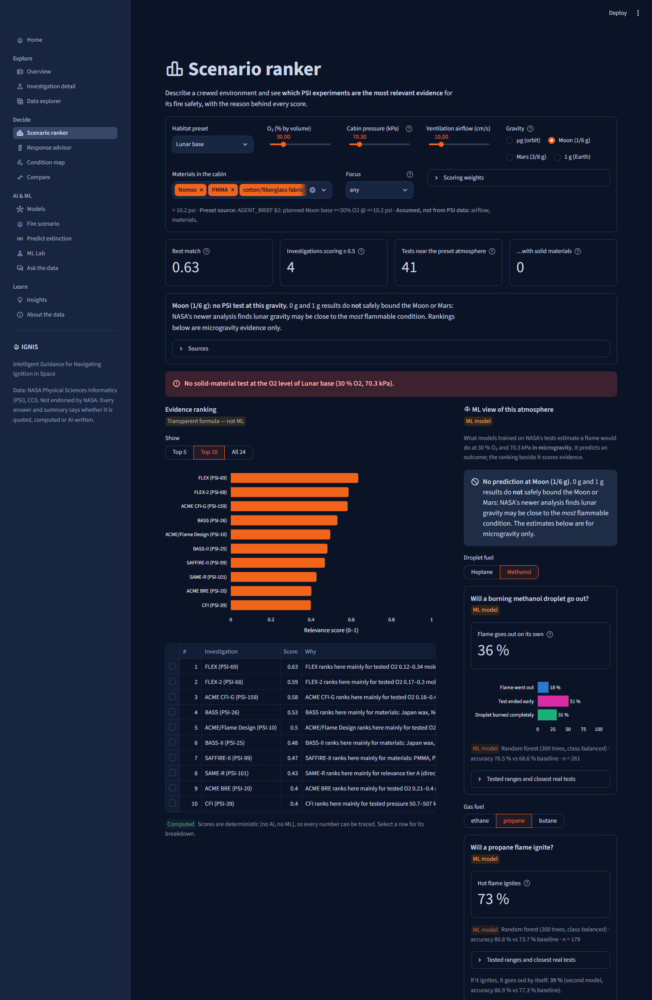
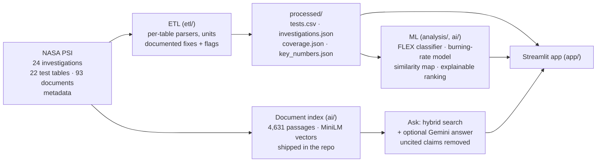

# Flame in Freefall — fire-safety insights from NASA microgravity combustion data

*NASA Space Apps Challenge 2026 · challenge "Flame in Freefall: SI-Powered Fire Safety Insights from
Microgravity Combustion Data". Project name: **[to be decided]** · Live demo: **[Streamlit URL — pending]***

NASA has flown decades of fire experiments in microgravity, but the results sit in 24 separate
investigations in the [Physical Sciences Informatics (PSI)](https://psi.nasa.gov) repository —
66,567 files, ~13.5 TB, every table in its own format. This dashboard turns them into answers for
the people designing crewed spacecraft, Moon and Mars bases and pressurized rovers: **which
experiments matter for my habitat, what do they show, and where is there no evidence at all?**



**Key finding:** across 1,947 test records, **no solid material — the fabrics and plastics that make up
a habitat's fire load — was tested near the planned Moon-base atmosphere (≥30 % O₂, ≤70 kPa)**. Solids
were tested only up to 22.2 % O2. And because microgravity flame spread is most vigorous at low flow
speeds (Olson & Ferkul's "Goldilocks" zone, PSI-62), lunar gravity may be worse than both 0 g and 1 g.

## How it answers the challenge

| Challenge asks (brief §1) | Where in the app |
|---|---|
| R1 web-based, interactive dashboard | the whole Streamlit app: 11 pages |
| R2 "SI-powered" — AI used meaningfully | **Ask the data** (semantic search + optional Gemini answers, every claim cited) · **Predict extinction** (ML classifier) · **Compare** (embedding-based similarity map) |
| R3 summarize investigations | **Overview**, **Investigation detail** (summary + the investigators' own words + documents) |
| R4 rank investigations | **Scenario ranker**: explainable score per habitat, adjustable weights, data gaps per result |
| R5 interpret → fire-safety insights | **Insights** (prevention / detection / suppression), data gaps on **Condition map** |
| S1 relevance to spacecraft, ISS, Moon/Mars bases, rovers | ranker presets: ISS, Lunar base, Exploration atmosphere, Mars base, Pressurized rover, Spacesuit |
| S2 data for predictive modeling | **Data explorer** (clean, unit-normalized tests, CSV download) · FLEX outcome + burning-rate models |
| S3 next-generation controls & equipment | **Insights** by pillar; detection (SAME/DAFT), suppression (FLEX CO₂/He) |
| C1 Earth applications | **Insights** → NASA spinoffs (water mist, smoke vs dust detection, firefighter gear) |
| C2 objectives, fuels, conditions, varied vs fixed variables, sensors | **Investigation detail** + **Data explorer** |
| C3 similarities and differences between investigations | **Compare** (side by side + similarity map with shared facts) |

## How it works



| Layer | What | Details |
|---|---|---|
| Data cleaning | 21 PSI experiment tables → 1,947 test records in common units (O₂ fraction, kPa, cm/s, mm) | [etl/](etl/) · every correction (spreadsheet auto-fill, unit errors, typos) is flagged with the PSI document that justifies it; nothing is guessed |
| Search / Q&A | 93 PDF/Word documents → 4,631 passages with file + page; local embeddings + keyword search | [ai/README.md](ai/README.md) · Gemini (free tier) writes answers only from retrieved passages when a key is set |
| ML | FLEX outcome classifier (random forest, 76.5 % accuracy vs 68.6 % baseline, 261 tests); burning-rate regression (R² ≈ 0.70, n = 257); similarity map (7 clusters, recovers 14 of 18 PSI "related investigation" links) | [analysis/README.md](analysis/README.md) · models refuse to extrapolate beyond tested ranges |
| App | 11 pages, works with no API key | [app/README.md](app/README.md) |

## Data honesty

- **Every number is computed**, in one place: [processed/key_numbers.json](processed/key_numbers.json); a test
  fails if this README or the submission texts disagree with it.
- **Corrections are visible.** 562 rows carry a `flags` entry such as *"thickness 3.7 mm → 0.37 mm (header
  says cm; SIBAL fabric is 0.33 mm per the SAFFIRE document, p. 3)"*; the **Data explorer** shows the flag
  next to the original PSI row. Remaining parse problems are listed in
  [processed/etl_log.csv](processed/etl_log.csv).
- **Not guessed:** missing values stay empty ("no data", never 0). Burner O₂ in inverse flames (up to 85 %)
  is never compared with a cabin atmosphere; the highest atmosphere O₂ tested is 40 %.
- **Limitations:** the prediction models cover liquid-fuel droplets (FLEX), not solid materials; PSI has
  no partial-gravity combustion data; some PSI metadata dates are incomplete; PSI raw data (videos,
  images) is linked, not downloaded.

## Run it locally

```bash
# Windows: some NASA document names are very long -> enable long paths or git refuses to check out
git clone -c core.longpaths=true https://github.com/fswierta/nasa-hackathon
cd nasa-hackathon
python -m pip install -r requirements.txt      # Windows without python on PATH: py -m pip ...
python -m streamlit run app/main.py            # opens http://localhost:8501
```

No API key is needed: search, ranking, the prediction models and the similarity map run locally.
Optional: copy `.env.example` to `.env` and add a Google Gemini key (free tier) for generated chat
answers — note that questions are then sent to Google. The first search downloads an 80 MB embedding
model once. Tests: `python -m pytest etl/tests ai/tests app/tests analysis/tests -q`.

Rebuild the data from the PSI files: `python etl/parse_tests.py && python etl/build_investigations.py &&
python etl/build_coverage.py && python -m analysis.flex_classifier && python -m analysis.similarity &&
python etl/build_key_numbers.py`.

## Use of AI, data and licence

- AI tools in the product and in building it: [submission/ai_disclosure.md](submission/ai_disclosure.md).
- Data: NASA Physical Sciences Informatics, **CC0 1.0**; each investigation is cited by its PSI DOI
  (10.60555/…) in the app. Challenge text and the 2015 *Researcher's Guide to ISS Combustion Science*
  are in [project-data-1-pc1/data/reference/](project-data-1-pc1/data/reference/).
- This is an independent hackathon project. **It is not endorsed by NASA** and does not use the NASA logo.

## Team

[names and roles — to be filled in]

<sub>Built by three people working in parallel with Claude Code agents; coordination notes for the agents
are in [CLAUDE.md](CLAUDE.md), tasks are GitHub Issues.</sub>
